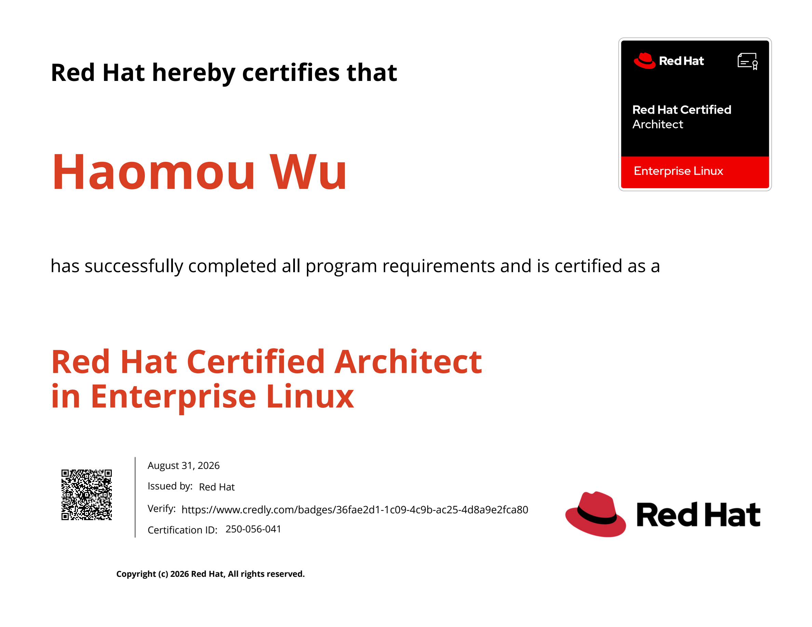
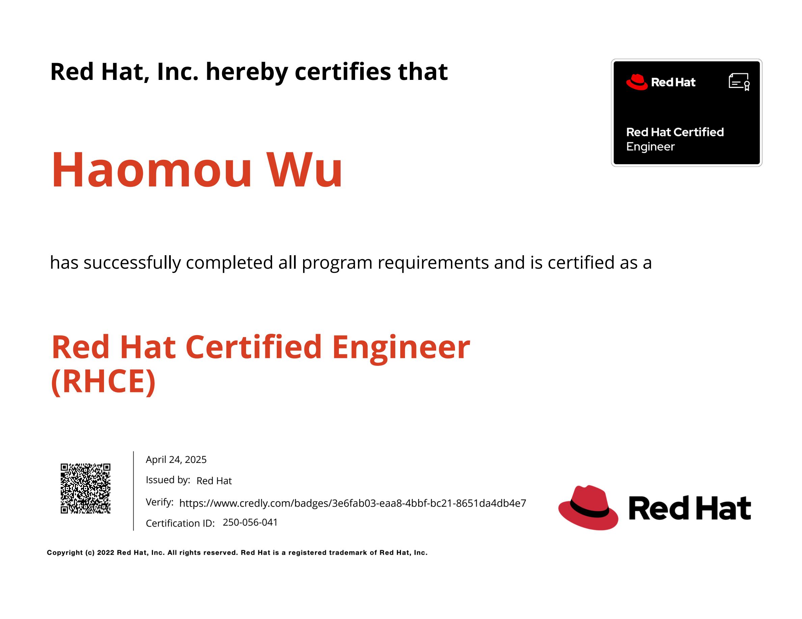
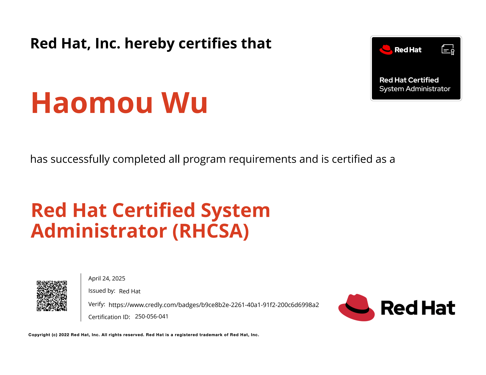
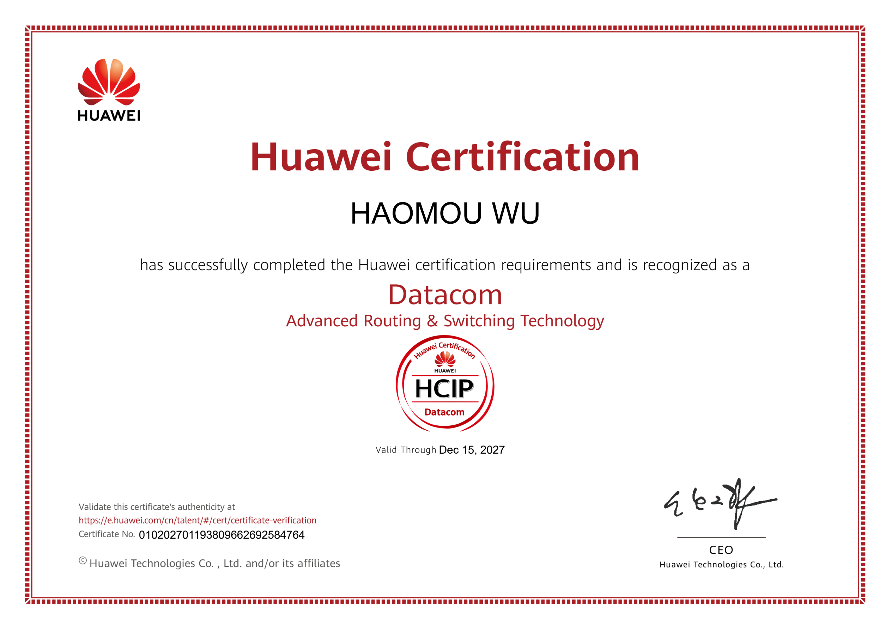

### Hi, I'm krictfus 👋

**English** — An ordinary Linux ops engineer moving from *classic operations* towards *automation / platform*

work. **I have just started using GitHub**; this profile and my project are my first serious attempt here.
Code is written with AI assistance — the architecture, the constraints and the lessons learned came from my
own field work. Red Hat certified: **RHCA** plus seven more current credentials (verifiable in one click
below). Main project: [agentless-fieldkit](https://github.com/krictfus/agentless-fieldkit) — a
payload-pluggable batch task runner for isolated, no-platform environments. **Feedback is very welcome.**

---

### 你好，我是 krictfus

普通的 Linux 运维，正在从"传统运维"往 **自动化 / 平台方向** 走。

- 🔭 目前在做：**[agentless-fieldkit](https://github.com/krictfus/agentless-fieldkit)** —— 面向隔离网络、
  无平台环境的**载荷可替换批量任务框架**
- 🌱 正在学：CL260（Ceph 存储）、DO374（Ansible 自动化平台）；**GitHub 也是刚上手**
- 🎓 认证：**RHCA** + 7 项红帽当前有效认证（一键在线验证见下）
- 💬 交流：欢迎开 issue 或直接找我。我开仓库主要是想**得到指导**，不是来证明什么
- 🧭 一路走来：计算机网络专科 → RHCSA/RHCE → RHCA → 真实机房交付。
  **代码借助 AI 完成，但架构、约束与踩过的坑是我自己的**

---

## 认证 / Certifications

🔎 **官方一键验证**：https://rhtapps.redhat.com/verify?certId=250-056-041
（点进去就是红帽官网的实时验证结果，不需要相信这里写的任何字）

🔖 **Credly 官方徽章**：[RHCA](https://www.credly.com/badges/36fae2d1-1c09-4c9b-ac25-4d8a9e2fca80)
｜ [RHCE](https://www.credly.com/badges/4e06e1c5-1e57-4d5b-bbb6-e087e7066b78)
｜ [RHCSA](https://www.credly.com/badges/6ab2135d-7092-4cf9-b368-63f03614b2e1)

| 认证 | 考试 | 取得时间 | 有效期至 |
|---|---|---|---|
| **RHCA** — Red Hat Certified Architect in Enterprise Linux | — | 2026-08-31 | 2029-08-31 |
| **RHCE** — Red Hat Certified Engineer in Enterprise Linux | EX294 | 2025-04-24 | 2029-08-31 |
| **RHCE** — Red Hat Certified Engineer in Ansible | EX294 | 2025-04-24 | 2029-08-31 |
| **RHCASA** — Certified Advanced System Administrator in Ansible | — | 2025-04-24 | 2029-08-31 |
| **RHCSA** — Red Hat Certified System Administrator | EX200 | 2025-04-24 | 2029-08-31 |
| **RHCS** — Specialist in Linux Performance Tuning | EX442 | 2026-07-13 | 2029-08-31 |
| **RHCS** — Specialist in High Availability Clustering | EX436 | 2026-08-31 | 2029-08-31 |
| **RHCS** — Specialist in Services Management and Automation | EX358 | 2026-05-19 | 2029-08-31 |

📄 证书原件（点击展开 4 张图）

**RHCA**（Red Hat Certified Architect in Enterprise Linux）

**RHCE**（Red Hat Certified Engineer in Enterprise Linux）

**RHCSA**（Red Hat Certified System Administrator）

**HCIP-Datacom**（华为认证 ICT 专业级 · 数据通信，2024-12）

### 更早的底子（不是红帽体系，但构成了起点）

我大学的专业是**计算机网络**，HCIP-Datacom 是我毕业之后**自学考的**（2024-12-15 取得，有效期至 2027-12-15）。
老实说：**那些协议细节我早就忘光了** —— 后来转去做 Linux，一部分原因也是当时觉得网络这条路走不宽。

但有意思的是，**那些基本概念我一直在用**：网段、网关、路由、二层/三层……
这个项目里[「控制端虚拟机的网络打通」](https://github.com/krictfus/agentless-fieldkit/blob/main/README.md)那一节，
就是这些底子在起作用。

华为证书编号（可在华为认证官网查询）：`010202701193809662692584764`

---

## 作品 / Projects

### [agentless-fieldkit](https://github.com/krictfus/agentless-fieldkit)

载荷可替换的批量任务执行框架：给它一份主机清单 + 一份你自己的脚本，它负责下发一次性密钥、并行执行、
按台回收产物、分类结果，并在目标机上**零残留**（含失败路径）。
**不需要平台、不需要预置凭据，操作者只需要会 `cd` 和 `vim`。**

- 实测：三层漏斗让"2 台可达 + 1 台口令错 + 1 台不可达"从 **138 秒降到 21 秒**；单台端到端约 10~12 秒
- 最新版本：[**v3.4.0**](https://github.com/krictfus/agentless-fieldkit/releases/tag/v3.4.0)
  （Release 附件含控制端镜像，附 sha256 可校验）
- 中文说明（权威版本）：[README.md](https://github.com/krictfus/agentless-fieldkit/blob/main/README.md)
- 设计理由（为什么这么设计）：[docs/DESIGN.md](https://github.com/krictfus/agentless-fieldkit/blob/main/docs/DESIGN.md)

---

## 正在学什么 / Currently learning

| 方向 | 状态 |
|---|---|
| Linux 传统运维（RHEL 体系） | **主战场** |
| Ansible / 自动化与批量交付 | 在用，持续深入 |
| Ceph 存储（CL260） | 进行中 |
| Ansible 自动化平台（DO374） | 进行中 |
| GitHub / Git 协作 | **刚起步**（这是我第一次正经用 GitHub） |
| 云原生 / Kubernetes | 尚未接触 |

---

> 中文文档是这个账号的权威版本；英文内容以摘要为主。
> The Chinese docs are authoritative on this account; English content is mostly summary.

